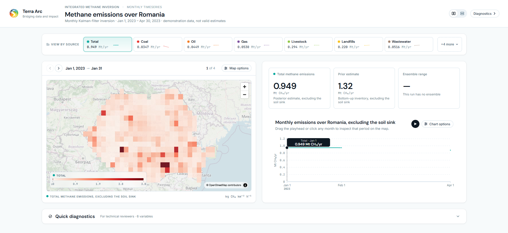

# IMI Dashboard

`imi-dashboard` turns the outputs of an
[Integrated Methane Inversion](https://imi.seas.harvard.edu/) (IMI) run into an
interactive web dashboard. 

The dashboard shows emission maps per period and sector, posterior and
prior totals, a timeseries chart for multi-period runs, and the inversion's
diagnostics. The dashboard is a folder of static files: preview it locally or
put it on any static web host.

The IMI, from Harvard's Atmospheric Chemistry Modeling Group, estimates
regional methane emissions from TROPOMI satellite observations with the
GEOS-Chem model. This repository is an independent project of Terra Arc S.M.P.C., not
affiliated with or endorsed by the IMI team.



## Install

Python 3.11 or later.

**From a release (recommended):** download the wheel from the
[releases page](https://github.com/Terra-Arc/imi-dashboard/releases). It
includes the dashboard's pages, so no Node.js is needed.

```bash
pip install imi_dashboard-<version>-py3-none-any.whl
```

**From source:** also needs Node.js 20.19 or later, to build the pages from
`web/`.

```bash
git clone https://github.com/Terra-Arc/imi-dashboard.git
cd imi-dashboard
npm --prefix web install && npm --prefix web run build
python -m venv .venv && source .venv/bin/activate     # Windows: .venv\Scripts\activate
pip install -e tools/imi-dashboard
```

## Quick start

The input is the folder the IMI's visualization notebook writes:
`<run>/inversion/output/` (single inversion) or `<run>/kf_inversions/output/`
(Kalman filter). IMI 2.1.0 or later.

```bash
imi-dashboard info    my_run/kf_inversions/output                # what the converter finds
imi-dashboard convert my_run/kf_inversions/output my_dashboard   # build the dashboard
imi-dashboard serve   my_dashboard --open                        # preview it
```

Re-running `convert` converts only new or changed periods. With the sample
in the source tree:

```bash
imi-dashboard convert sample_files/timeseries dashboards/romania --config examples/config.example.yaml
imi-dashboard serve dashboards/romania --open
```

`imi-dashboard init-config <input>` writes `dashboard.yaml`, a commented
config (title, sectors, branding, base map) with your run's values; edit it
and pass it with `--config`. To share a dashboard, upload its folder to a
static host (GitHub Pages, Netlify, S3, …); it does not work opened from disk.

## Documentation

- [User guide](docs/guide.md): what the dashboard shows, input files, options,
  config keys, hosting.
- [Running it with the IMI](docs/imi-integration.md): building the dashboard as
  part of an IMI run.
- [Contributing](CONTRIBUTING.md) · [Changelog](CHANGELOG.md)

## License

Apache License 2.0, copyright Terra Arc S.M.P.C. ([`LICENSE`](LICENSE),
[`NOTICE`](NOTICE)). The data in `sample_files/` has its own terms
([`sample_files/README.md`](sample_files/README.md)).
